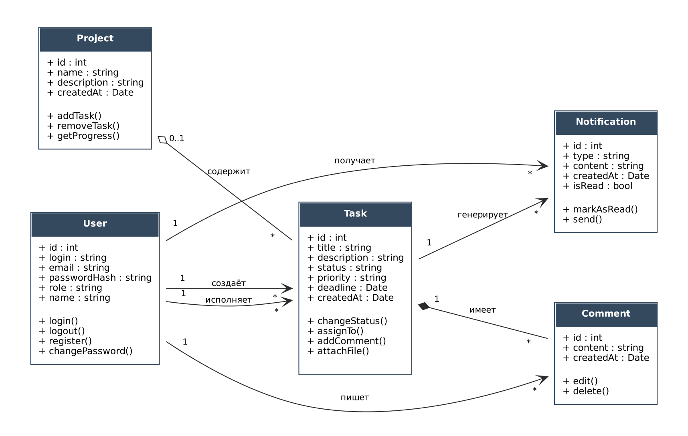
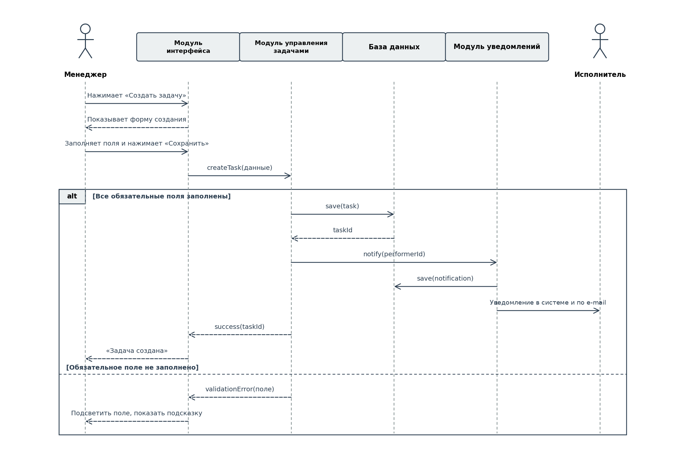

Задание 5. UML-диаграммы и тест-кейсы

**9. Диаграмма классов**

На диаграмме классов представлены восемь основных сущностей системы: User, Task, Project, Comment, Notification, Attachment, TaskHistory и ActionLog. Они напрямую соответствуют функциональным требованиям и архитектуре из предыдущих заданий — каждая сущность хранит данные, которыми оперируют соответствующие модули.

Описание классов и их связей:

| **Класс**        | **Назначение**                                                                                                   | **Связи**                                                                                                     |
|------------------|------------------------------------------------------------------------------------------------------------------|---------------------------------------------------------------------------------------------------------------|
| **User**         | Пользователь системы любой роли (исполнитель, менеджер, администратор). Хранит учётные данные и личные сведения. | Связан с Task (как автор и как исполнитель), Comment (автор), Notification (получатель).                      |
| **Task**         | Задача — основная сущность системы. Имеет название, описание, срок, приоритет и статус.                          | Может входить в Project, связан с User (автор, исполнитель), имеет Comment и Notification. |
| **Project**      | Проект — группа связанных задач, объединённых общей целью или командой.                                          | Содержит множество Task (агрегация).                                                                          |
| **Comment**      | Комментарий к задаче от исполнителя или менеджера.                                                               | Относится к одной Task и одному User-автору.                                                                  |
| **Notification** | Уведомление о событии в системе (новая задача, изменение статуса, приближение срока).                            | Связан с User-получателем и Task, к которой относится событие.                                                |
| **Attachment**   | Файл, прикреплённый к задаче (ФТ 6): имя, размер, дата загрузки. | Относится к одной Task (композиция), не более 10 на задачу. |
| **TaskHistory**  | Запись истории изменений задачи (ФТ 17): какое поле изменилось, старое и новое значение, время. | Относится к одной Task (композиция), связана с User — автором изменения. |
| **ActionLog**    | Запись журнала действий пользователя (ФТ 15): действие, подробности, время. | Связана с User, совершившим действие. |

Связи между классами:

- User «один-ко-многим» Task — один пользователь может создавать множество задач и быть исполнителем многих задач (две связи с разными ролями).

- Project «один-ко-многим» Task — агрегация: задача может входить в проект (не более чем в один), но может существовать и без него — по ФТ 7 и ФТ 10 задачу сначала создают, а потом объединяют в проект.

- Task «один-ко-многим» Comment — композиция: комментарии привязаны к задаче и не имеют смысла без неё.

- Task «один-ко-многим» Notification — задача является источником уведомлений о связанных с ней событиях.

- User «один-ко-многим» Comment и User «один-ко-многим» Notification — пользователь пишет комментарии и получает уведомления.

- Task «один-ко-многим» Attachment и Task «один-ко-многим» TaskHistory — композиция: файлы и записи истории не существуют без задачи.

- User «один-ко-многим» TaskHistory и User «один-ко-многим» ActionLog — пользователь является автором изменений задачи и действий в журнале.

**10. Диаграмма последовательности**

Для диаграммы последовательности выбран сценарий «Создание новой задачи», описанный в задании 3. Диаграмма показывает взаимодействие участников и модулей системы во времени: менеджер инициирует действие через интерфейс, далее модуль управления задачами сохраняет данные в БД и инициирует уведомление исполнителю. Альтернативная ветка отражает поведение системы при незаполненном обязательном поле.

Сплошными стрелками показаны синхронные вызовы, пунктирными — ответы. Блок alt разделяет нормальный ход выполнения и обработку ошибки валидации.

**11. Тест-кейсы**

Ниже приведены десять тест-кейсов, охватывающих ключевые сценарии работы системы: создание задачи, валидацию, изменение статуса, авторизацию, отображение просроченных задач, отчётность и синхронизацию офлайн-изменений. Каждый тест связан с конкретным функциональным или нефункциональным требованием из предыдущих заданий.

| **№** | **Что проверяется**                | **Действия**                                                                                                                                    | **Ожидаемый результат**                                                                                                          |
|-------|------------------------------------|-------------------------------------------------------------------------------------------------------------------------------------------------|----------------------------------------------------------------------------------------------------------------------------------|
| **1** | **Успешное создание задачи**       | Менеджер открывает форму создания задачи, заполняет название, описание, выбирает исполнителя, указывает срок и приоритет, нажимает «Сохранить». | Задача создана и появилась в списке исполнителя, исполнитель получил уведомление, изменение записано в историю.                  |
| **2** | **Валидация обязательных полей**   | Менеджер нажимает «Сохранить», не выбрав исполнителя.                                                                                           | Поле «Исполнитель» подсвечивается красным, выводится подсказка, задача не сохраняется.                                           |
| **3** | **Изменение статуса исполнителем** | Исполнитель открывает свою задачу в статусе «Новая» и меняет статус на «В работе».                                                              | Статус задачи обновлён, менеджер получил уведомление, изменение зафиксировано в истории с указанием автора и времени.            |
| **4** | **Авторизация с неверным паролем** | Пользователь вводит существующий логин и неверный пароль, нажимает «Войти».                                                                     | Система выводит сообщение «Неверный логин или пароль», доступ не предоставляется, попытка фиксируется в журнале.                 |
| **5** | **Просмотр просроченных задач**    | Исполнитель открывает свой список задач, у одной из них срок выполнения уже истёк.                                                              | Просроченная задача отображается отдельно от текущих и помечена визуально (цвет, иконка).                                        |
| **6** | **Формирование отчёта менеджером** | Менеджер открывает раздел «Отчёты», выбирает период «За последний месяц», нажимает «Сформировать».                                              | Система выводит количество выполненных и просроченных задач за указанный период с разбивкой по исполнителям.                     |
| **7** | **Офлайн-синхронизация**           | Исполнитель меняет статус задачи без подключения к интернету, затем восстанавливает соединение.                                                 | Изменение сохраняется локально, при появлении сети автоматически передаётся на сервер; индикатор «не синхронизировано» исчезает. |
| **8** | **Назначение роли администратором** | Администратор открывает раздел «Пользователи», выбирает пользователя с ролью «исполнитель», назначает ему роль «менеджер» и сохраняет. | Роль изменена; при следующем входе пользователю доступна кнопка «Создать задачу»; в журнале действий появилась запись с именем администратора и временем. |
| **9** | **Прикрепление файла сверх лимита** | Исполнитель прикрепляет к своей задаче файл размером 15 МБ, затем файл размером 5 МБ. | Файл 15 МБ не загружается, выводится сообщение «Размер файла не должен превышать 10 МБ»; файл 5 МБ прикрепляется и виден в карточке задачи. |
| **10** | **Уведомление о приближении срока** | У задачи в статусе «в работе» до срока выполнения осталось 24 часа; у второй задачи того же исполнителя статус «выполнена» и тот же срок. | По первой задаче исполнитель получает уведомление в системе и письмо на e-mail с названием задачи и сроком; по второй задаче уведомление не отправляется. |
